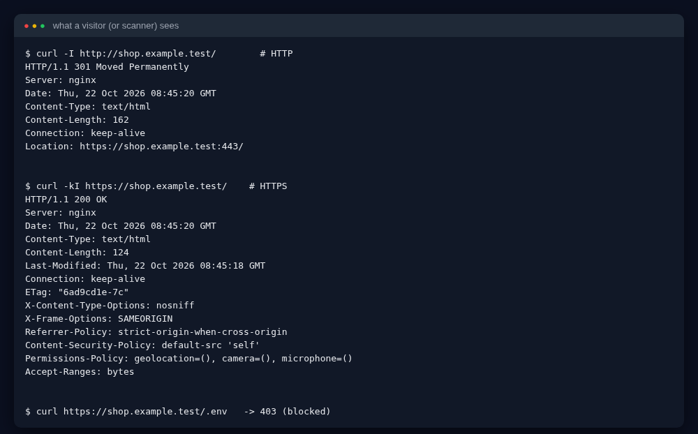
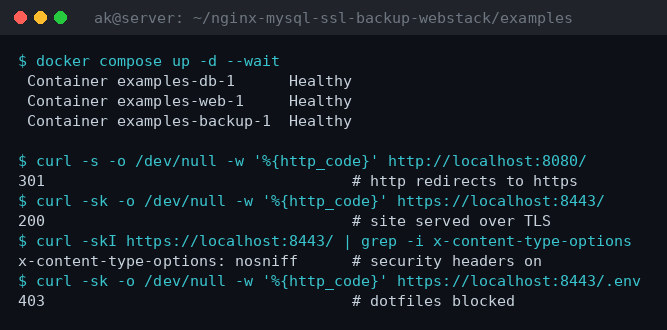
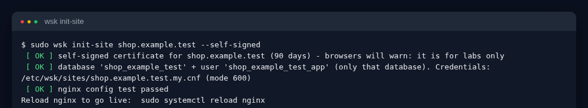
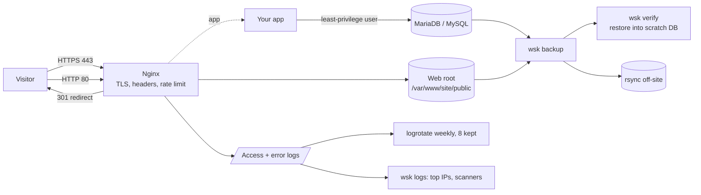
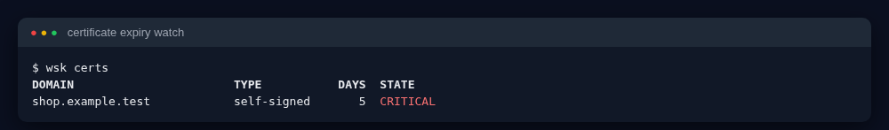
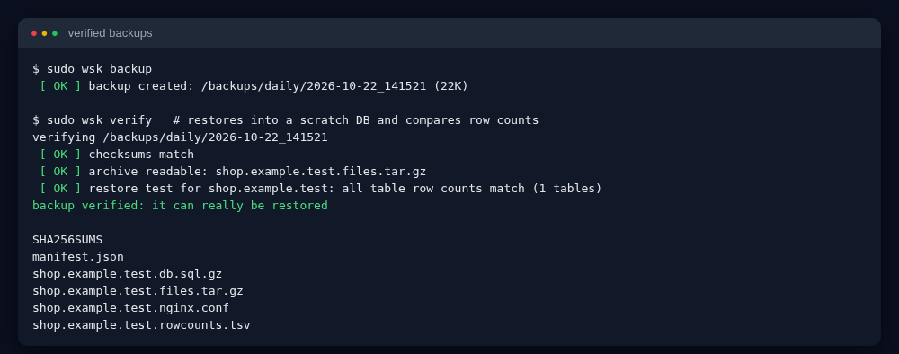
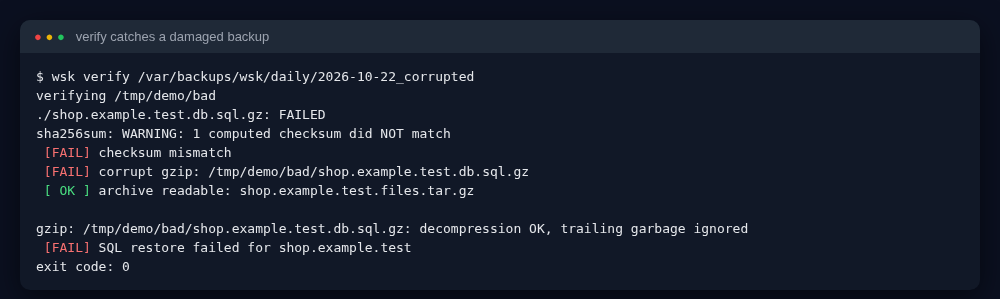
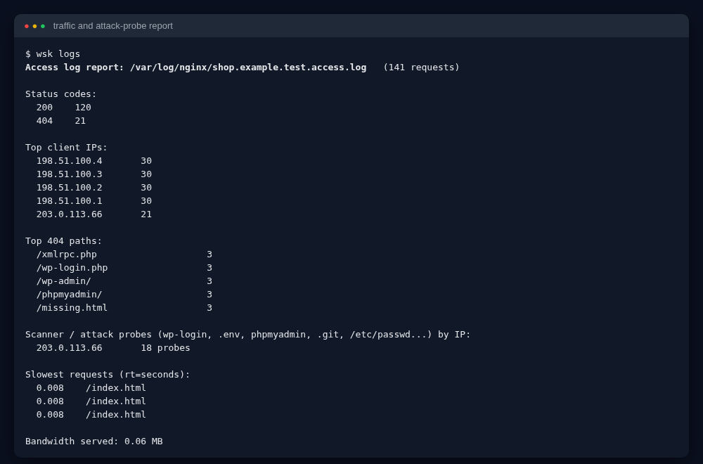
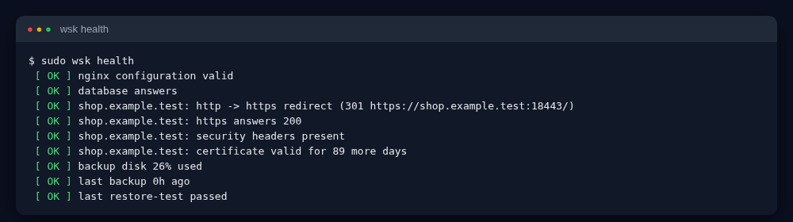

# Nginx + MariaDB/MySQL + SSL + Verified Backups Web Stack (`wsk`)

[](https://github.com/AKASH991833/nginx-mysql-ssl-backup-webstack/actions/workflows/ci.yml)
[](https://github.com/AKASH991833/nginx-mysql-ssl-backup-webstack/releases)
   

A production-style web server stack you can build in one command and *understand* from zero: **Nginx** (hardened, HTTPS, security headers, rate limiting) + **MariaDB/MySQL** (least-privilege user per site) + **TLS** (Let's Encrypt or self-signed lab certs) + **automatic backups that are proven restorable** + **log rotation and log analysis** + an end-to-end **health check**.

Everything is one readable Bash tool: `wsk`.



**20-second demo** (real CI output: init-site, HTTPS answers, backup proven by restore):



## What makes this different

| Feature | Why it matters |
|---|---|
| **Backups are verified by really restoring them** | `wsk verify` restores the dump into a scratch database and compares the row count of every table with the counts recorded at backup time. A backup you never restored is a hope, not a backup. A corrupted file is caught (checksum + gzip + restore). |
| **Grandfather-father-son retention with hard links** | Daily (7), weekly (4), monthly (6) copies, promoted with `cp -al`, so weekly/monthly cost almost no extra disk. |
| **Off-site copy** | Optional `rsync` after every backup (`WSK_RSYNC_TARGET`). |
| **One command per site** | `wsk init-site` creates the web root, certificate, nginx vhost, database, a *separate* DB user limited to that one database, and a 600-mode credentials file. The generated nginx config is tested with `nginx -t` before it is kept (and removed if invalid). |
| **Secure by default** | TLS 1.2/1.3 only, HTTP to HTTPS redirect, version hidden, CSP/nosniff/X-Frame/Referrer/Permissions headers, rate limit, dotfiles and `.sql/.bak` blocked. |
| **Attack-probe report** | `wsk logs` shows top IPs, status codes, 404 paths and which IPs probe for `wp-login`, `.env`, `phpmyadmin`, `.git`. |
| **Certificate watchdog** | `wsk certs` lists days left; exit code 1 (renew soon) and 2 (critical) so cron/monitoring can alert. |
| **Tested for real** | The test-suite starts a real nginx and a real MariaDB (no root, no Docker) and checks 34 behaviours. |

> Preparing for an interview? Read [INTERVIEW.md](INTERVIEW.md) (60-second pitch, design choices, 10 Q&A).

## Quick start (60 seconds to a running HTTPS site, on a fresh Ubuntu VM)

```bash
git clone https://github.com/AKASH991833/nginx-mysql-ssl-backup-webstack.git
cd nginx-mysql-ssl-backup-webstack
sudo ./wsk install                                   # nginx, mariadb, certbot, rsync, logrotate
sudo ./wsk init-site example.com --self-signed       # lab: self-signed cert
# production: sudo ./wsk init-site example.com --letsencrypt you@example.com   (DNS must point here, port 80 open)
sudo systemctl reload nginx
sudo ./wsk backup && sudo ./wsk verify               # first backup + restore test
sudo ./wsk health                                    # everything green?
sudo ./wsk timers --apply                            # schedule backup, verify, certs, health
sudo ./wsk logrotate                                 # log rotation policy
```


## Learn it from zero: every part explained

### 1. What is a "web stack"?
A visitor types your address. **DNS** turns the name into an IP. The browser connects to **Nginx** (the web server) on port 443. Nginx serves static files itself, or passes requests to an app. The app stores data in a **database** (MariaDB/MySQL). That chain is the stack. This repo sets up the *foundation* and everything an admin needs around it (certificates, backups, logs, monitoring).



### 2. Nginx and what `init-site` writes
- **Two server blocks**: port 80 only redirects (`301`) to HTTPS (and keeps `/.well-known/acme-challenge/` open for Let's Encrypt); port 443 serves the site.
- `server_tokens off` hides the version, so scanners cannot look up exploits for your exact build.
- `ssl_protocols TLSv1.2 TLSv1.3`: old SSL/TLS 1.0/1.1 are broken and refused (tested).
- Security headers: `X-Content-Type-Options`, `X-Frame-Options` (anti clickjacking), `Content-Security-Policy`, `Referrer-Policy`, `Permissions-Policy`, and HSTS (only when a real certificate is used, because HSTS with a self-signed cert would lock you out of your own lab).
- `limit_req` allows 10 requests/second per IP with a burst of 20: slows brute force and scrapers.
- `location ~ /\.` blocks `.env`, `.git`, `.htaccess`; `.sql/.bak` leftovers are blocked too.
- Per-site `access.log` / `error.log` with response time (`rt=`) so you can find slow pages.

### 3. TLS certificates
HTTPS encrypts traffic and proves identity. **Let's Encrypt** issues free 90-day certificates via `certbot` (needs a real domain pointing to your server). **Self-signed** certificates are for labs: the connection is encrypted but browsers warn. `wsk certs` shows days left; `wsk certs renew DOMAIN` renews. Renewal is also the thing people forget, so `wsk timers` checks daily and `wsk health` fails when under 7 days.


### 4. The database, safely
`init-site` creates database `shop_example_com` and user `shop_example_com_app` that can only touch **that** database (no `GRANT ALL ON *.*`, no DROP). If an app is hacked via SQL injection, other sites' data stays safe. The generated password is random (24 chars) and stored in a `0600` option file, never printed.

### 5. Backups you can trust
```bash
sudo ./wsk backup            # dump + files + nginx conf + SHA256SUMS + manifest + row counts
sudo ./wsk verify            # prove the latest one restores
sudo ./wsk restore /var/backups/wsk/daily/2026-10-22_021500 example.com --yes
```
What a backup contains: `site.db.sql.gz` (dump with `--single-transaction`, so no table locks and a consistent snapshot; includes routines, triggers, events), `site.files.tar.gz`, the nginx vhost, `SHA256SUMS`, `rowcounts.tsv`, `manifest.json`. Folder is mode 700 (dumps contain your data).

Damaged backups are detected:


**Retention (GFS)**: `daily/` keeps 7, `weekly/` (Sundays) keeps 4, `monthly/` (1st of month) keeps 6. Change in `/etc/wsk/wsk.conf` (see `config/wsk.conf.example`).

### 6. Logs and log rotation
Logs grow forever and fill the disk. `wsk logrotate` installs a policy: weekly, keep 8, compress, tell nginx to reopen files (`USR1`). `wsk logs` turns raw lines into answers:


### 7. Health check
`wsk health` verifies nginx config, DB answer, HTTP to HTTPS redirect, HTTPS 200, headers, version hidden, certificate days, disk space of the backup volume, backup age (<26h) and the last restore-test. Exit code 0 ok, 1 warning, 2 critical, so it plugs into cron, Nagios, Zabbix, or Uptime Kuma.


## Command reference
| Command | Purpose |
|---|---|
| `wsk install` | install packages (apt or dnf) |
| `wsk init-site DOMAIN [--self-signed \| --letsencrypt EMAIL] [--db NAME] [--http-port N --https-port N] [--skip-db]` | create a complete site |
| `wsk backup` / `wsk verify [DIR]` / `wsk restore DIR SITE --yes` | backup, prove, restore |
| `wsk certs [list \| renew DOMAIN]` | certificate expiry |
| `wsk logs [ACCESS_LOG]` / `wsk logrotate` | log analysis / rotation |
| `wsk health [--json]` | full health check |
| `wsk timers [--apply]` | cron schedule (02:30 backup, Sunday verify, daily certs, 5-min health) |

Environment variables (`WSK_*`) let you relocate every path, so you can also run it unprivileged for testing (that is how the tests work). Container lab: `examples/` (docker compose) - built and verified on every push by the `compose-lab` CI job; see `examples/README.md`.

## Honest test report
- `tests/run.sh`: **34 checks pass** against a *real* nginx 1.18 and *real* MariaDB 10.6 started as a normal user on ports 18080/18443: site creation, `nginx -t`, redirect 301, HTTPS 200, security headers, hidden version, `.env` blocked (403), TLS 1.1 refused, DB user isolation, backup contents, restore into scratch DB, corrupted backup detected, restore of dropped table and deleted files, GFS retention + hard links, rsync off-site identity, certificate expiry exit codes, log analysis, `logrotate -d` accepts the policy, cron file, health fails when nginx is down.
- ShellCheck clean (`-S error`).
- **Not run in the author's sandbox** (needs root/systemd/internet): `wsk install`, real Let's Encrypt issuance, listening on ports 80/443, `systemctl`. The `real-server` job in GitHub Actions installs everything as root on a clean Ubuntu VM and runs `init-site`, `backup`, `verify`, `health`, `certs`, `logrotate` (see the CI badge).
- The docker-compose lab is exercised end-to-end by the `compose-lab` CI job on every push: containers start, HTTP 301 / HTTPS 200 / headers / dotfile-403 are checked, a backup is taken and **restored into a scratch database with row-count verification**.
- Let's Encrypt mode shells out to `certbot` and was not exercised.
- **CI result (Oct 22, 2026):** `lint-and-test` and `real-server` are green. The real-server run found and fixed a real bug (a second `gzip on` clashed with the distro nginx.conf) and a logrotate check that was too strict on the CI runner.
- The `rhel-family` CI matrix runs the same full integration suite (real nginx + real MariaDB) on Rocky 9, AlmaLinux 9, CentOS Stream 9 and Fedora (latest), all with dnf packages. Red Hat UBI 9 is deliberately excluded here: its free repos ship the MariaDB client but no `mariadb-server` package, so the suite cannot run there without a RHEL subscription (the other two projects in this profile do run their suites on UBI 9).

## Security notes
Never commit `/etc/wsk` (it holds DB credentials). Keep `wsk-backups` off the web root. Use SSH-key login for `WSK_RSYNC_TARGET`. Test `wsk restore` on a staging machine before you need it.

## License
MIT
